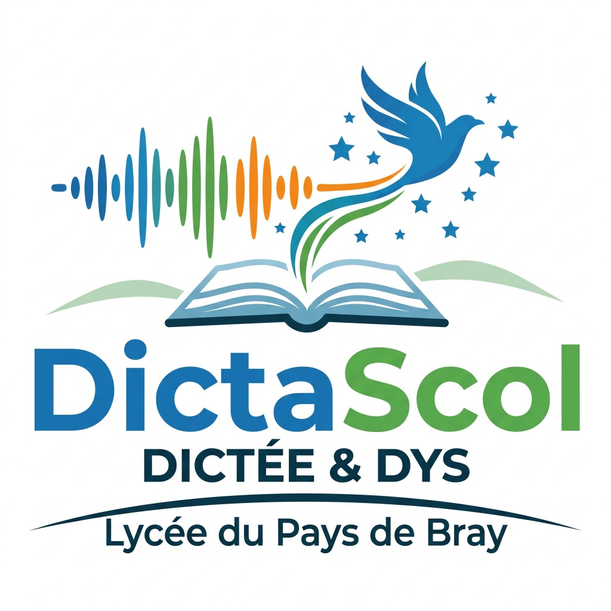

# 🎙️ DictaScol — Dictée & Dys (Lycée du Pays de Bray)

<p align="center">
  
</p>

Application web de dictée vocale qui transforme la parole en texte, exportable vers Google Docs.  
Conçue pour les élèves dyslexiques utilisant Google Workspace for Education.

---

## 🚀 Démarrage rapide (sans Google Docs)

L'application fonctionne **immédiatement** pour la dictée vocale et la copie de texte — aucune configuration requise.

### 1. Lancer un serveur local

L'appli a besoin d'un serveur web (la dictée vocale ne fonctionne pas depuis `file://`).

**Option A — Python (préinstallé sur la plupart des machines) :**
```bash
cd dictaphone
python -m http.server 8080
```

**Option B — Node.js :**
```bash
npx serve .
```

**Option C — VS Code :**  
Installe l'extension **Live Server**, clic droit sur `index.html` → *Open with Live Server*.

### 2. Ouvrir dans le navigateur

Va sur **http://localhost:8080** dans **Google Chrome** ou **Microsoft Edge**.

> ⚠️ La dictée vocale utilise la Web Speech API, qui fonctionne mieux sur Chrome/Edge.

### 3. C'est prêt !

- 🎤 Clique sur le micro pour dicter
- ✏️ Corrige le texte si besoin
- 📋 Copie le texte avec le bouton "Copier"

---

## 📄 Configuration de l'export Google Docs (optionnel)

Pour permettre aux élèves d'exporter directement vers Google Docs, il faut configurer un projet Google Cloud.

### Étape 1 — Créer un projet Google Cloud

1. Va sur [console.cloud.google.com](https://console.cloud.google.com/)
2. Connecte-toi avec le compte administrateur Google Workspace de l'établissement
3. Clique sur **Sélectionner un projet** → **Nouveau projet**
4. Nom : `DictaScol` → **Créer**

### Étape 2 — Activer l'API Google Drive

1. Dans le menu ☰ → **API et services** → **Bibliothèque**
2. Cherche **Google Drive API**
3. Clique dessus → **Activer**

### Étape 3 — Configurer Google Auth Platform (Écran de consentement OAuth)

Dans le menu ☰ → **API et services** → **Écran de consentement OAuth** (ou **Google Auth Platform**), utilise le menu de gauche :

1. **Branding** :
   - Nom de l'application : `DictaScol`
   - Adresse e-mail d'assistance : ton email admin
   - Coordonnées du développeur (en bas) : ton email admin → **Enregistrer**
2. **Audience** :
   - Choisis **Interne** (limité aux utilisateurs de ton domaine Google Workspace)
   - *(Ou **Externe** si tu testes avec un compte Gmail personnel : ajoute alors ton adresse dans "Utilisateurs de test")*
3. **Accès aux données** :
   - Clique sur **Ajouter ou supprimer des niveaux d'accès**
   - Tout en bas du panneau de droite ("Ajouter manuellement des niveaux d'accès"), colle :
     `https://www.googleapis.com/auth/drive.file`
   - Clique sur **Ajouter au tableau** → **Mettre à jour** → puis **Save** (Enregistrer) en bas de la page.

### Étape 4 — Créer l'identifiant client OAuth

1. Dans le menu de gauche de Google Auth Platform, clique sur **Clients** (ou **API et services** → **Identifiants**)
2. Clique sur **+ Créer un client** (ou **+ Créer des identifiants** → **ID client OAuth**)
3. **Type d'application** : **Application Web**
4. **Nom** : `DictaScol Web`
5. **Origines JavaScript autorisées** — clique sur **+ Ajouter un URI** et ajoute :
   - `http://localhost:8888` (pour tester en local)
   - `https://florentboullier.github.io` (pour GitHub Pages en production)
6. Clique sur **Créer**
7. **Copie l'ID client** (qui ressemble à `123456789-xxxxx.apps.googleusercontent.com`)

### Étape 5 — Configurer l'application et la liste des professeurs

1. Ouvre le fichier `app.js` et vérifie ton `GOOGLE_CLIENT_ID` :
   ```javascript
   const CONFIG = {
     GOOGLE_CLIENT_ID: '123456789-xxxxx.apps.googleusercontent.com',
     SCOPES: 'https://www.googleapis.com/auth/drive.file',
     SPEECH_LANG: 'fr-FR',
     TEACHERS_CSV: 'professeurs.csv',
   };
   ```
2. Pour modifier la liste des professeurs ou des matières, édite simplement les fichiers **`professeurs.csv`** et **`matieres.csv`** :
   - **`professeurs.csv`** (format `Civilité;Nom;Prénom;Email`) :
     ```csv
     Civilité;Nom;Prénom;Email
     Mme;Amand;Isabelle;isabelle.amand@lyceedupaysdebray.fr
     M.;Boullier;Florent;florent.boullier@lyceedupaysdebray.fr
     ```
   - **`matieres.csv`** (une matière par ligne) :
     ```csv
     Matière
     ALLEMAND
     ANGLAIS
     FRANÇAIS
     ```

> 💡 Quand l'élève choisit un professeur et une matière puis clique sur **Envoyer à [Nom du prof]**, le Google Doc est nommé **`[MATIÈRE] Titre de la copie - JJ/MM/AAAA`** et **automatiquement partagé en édition** avec le professeur.

### Étape 6 — Tester

1. Relance le serveur local
2. Ouvre l'appli → le bouton **Se connecter** apparaît
3. Connecte-toi avec un compte élève du domaine
4. Dicte du texte → clique **Google Docs**
5. Un Google Doc est créé dans le Drive de l'élève 🎉

---

## 🏫 Déploiement pour l'établissement

### Option 1 — GitHub Pages (gratuit, recommandé)

1. Crée un dépôt GitHub avec les fichiers du projet
2. Va dans **Settings** → **Pages** → **Source** : `main` / `root`
3. L'appli sera accessible sur `https://ton-user.github.io/dictascol/`
4. Ajoute cette URL dans les **origines autorisées** de ton projet Google Cloud

### Option 2 — Hébergement sur le réseau de l'établissement

Place les fichiers sur un serveur web interne (Apache, Nginx, IIS...) accessible en HTTPS.

> ⚠️ **HTTPS obligatoire** en production — la dictée vocale ne fonctionne pas en HTTP (sauf localhost).

---

## 🎯 Fonctionnalités

| Fonctionnalité | Description |
|---|---|
| 🎤 Dictée vocale | Reconnaissance vocale en français, en temps réel |
| 💬 Commandes vocales | "point", "virgule", "à la ligne", etc. |
| ✏️ Édition | Zone de texte éditable pour corriger |
| 🔈 Relecture audio | Synthèse vocale pour réécouter le texte |
| 📄 Export Google Docs | Crée un Doc dans le Drive de l'élève |
| 📋 Copier | Copie le texte dans le presse-papier |
| 🔤 Police adaptée | OpenDyslexic par défaut (basculable) |
| 💾 Sauvegarde auto | Brouillon sauvegardé automatiquement |
| 📱 Responsive | Fonctionne sur mobile, tablette, PC |
| ⌨️ Raccourci clavier | `Ctrl+Entrée` pour démarrer/arrêter la dictée |

---

## 🗂️ Structure du projet

```
dictaphone/
├── index.html        ← Page principale
├── style.css         ← Styles (dyslexie-friendly)
├── app.js            ← Logique de l'application
├── professeurs.csv   ← Liste des professeurs (modifiable directement)
├── matieres.csv      ← Liste des matières (modifiable directement)
└── README.md         ← Ce fichier
```

---

## 🌐 Compatibilité navigateurs

| Navigateur | Dictée vocale | Export Google Docs |
|---|---|---|
| Chrome (recommandé) | ✅ | ✅ |
| Edge | ✅ | ✅ |
| Firefox | ❌ | ✅ |
| Safari | ⚠️ Partiel | ✅ |
| Chrome Android | ✅ | ✅ |
| Safari iOS | ⚠️ Partiel | ✅ |

---

## ❓ FAQ

**Q : L'appli fonctionne-t-elle hors ligne ?**  
R : La dictée vocale nécessite une connexion internet (la reconnaissance se fait sur les serveurs de Google).

**Q : Les données vocales sont-elles stockées ?**  
R : Non. La Web Speech API de Chrome envoie l'audio aux serveurs Google pour la transcription, mais rien n'est stocké de notre côté. Le brouillon est sauvegardé localement dans le navigateur (localStorage).

**Q : Combien ça coûte ?**  
R : Tout est gratuit. La Web Speech API est incluse dans Chrome, et l'API Google Drive est gratuite dans les limites normales d'utilisation.

**Q : Peut-on utiliser l'appli sans Google Workspace ?**  
R : Oui ! La dictée et la copie fonctionnent sans compte Google. Seul l'export vers Google Docs nécessite une connexion.

